<p align="center">
  <picture>
    <source media="(max-width: 600px) and (prefers-color-scheme: light)" srcset=".github/assets/banner-phone-light.svg">
    <source media="(max-width: 600px)" srcset=".github/assets/banner-phone.svg">
    <source media="(prefers-color-scheme: light)" srcset=".github/assets/banner-light.svg">
    
  </picture>
</p>

<div align="center">

[](https://github.com/EquityBot/GrievousGreps/actions/workflows/ci.yml) [](https://github.com/EquityBot/GrievousGreps/actions/workflows/codeql.yml)<br>
[](https://nodejs.org/) [](LICENSE) [](https://github.com/trailhq/Trail-Code)

[Install](#install) · [Quick start](#quick-start) · [Measured recall](#measured-recall) · [Compared with upstream](#compared-with-upstream) · [Limits](#limits) · [Credits](#credits)

</div>

GrievousGreps is EquityBot's distribution of [Trail-Code](https://github.com/trailhq/Trail-Code), the code graph CLI for coding agents, formerly Graft. It maps every function in a repository and who calls it, so an agent can check what a change reaches before it edits.

Use it over upstream if your agent relies on `callers`. [Measured recall](#measured-recall) rose on most of 21 public repositories, though not all, and Rust recall is partial. It also makes no background network request until you ask for one, and it refuses to write through a symlink planted in a repository. It installs the same `trail` and `graft` commands, so agent configuration and every command work as they do upstream.

## Install

GrievousGreps has no npm package, so build it from source. You need Node 20.16 or later on the 20 line, or 22.3 or later, plus git and a C++ toolchain for the native grammars.

GrievousGreps and upstream both provide `trail` and `graft`, so remove any upstream copy first:

```bash
npm uninstall -g @trailhq/trail-code @nanonets/graft
```

Then build it and link the commands:

```bash
git clone https://github.com/EquityBot/GrievousGreps
cd GrievousGreps
npm ci
npm run build
npm link
trail --version
```

`npm link` points the commands at this folder, so keep it. The folder measured about 610 MB with its development dependencies. Installing writes nothing to your agents' settings.

To update, run `git pull`, `npm ci` and `npm run build` in the folder. `trail upgrade` refuses on this build, because the package on npm is upstream's.

## Quick start

In your repository:

```bash
trail init                           # build the map, create .trail/ and wire your agents
trail callers <symbol>               # who calls it
trail callers <symbol> --direction out   # what it calls
trail map                            # directory clusters, hubs and hotspots
trail grep <pattern>                 # every occurrence, grouped by enclosing symbol
```

`trail init` writes inside the repository, with the tool's own state in `~/.trail`. Claude Code's hooks go in the repository's `.claude` settings. That has a cost: a worktree or an ignored checkout has no hooks until you run `trail init` there.

`trail init --global` closes that gap by adding hooks to `~/.claude`, and to `~/.codex` for Codex, which run in every project on the machine. `trail uninstall` removes what either form wrote.

The map lives in `graft/`, a local cache to keep out of git.

## Measured recall

Recall is the share of real calls that `callers` found, pooled across the symbols, so a symbol or repository with many callers weighs more. Each row is 10 preregistered symbols on one public repository, with the truth written before any build ran on it. Upstream is 0.28.0 at `a44da3d`.

That order rests on this statement: the truth went into a local log that is not public, so nobody outside can prove it was committed first. One correction came after a first scoring pass: the target lines of httpx `to_bytes` and `create_ssl_context` were off by one. No required row changed.

<!-- BENCHMARK START: every figure from here to BENCHMARK END is regenerated by benchmark/run.mjs on the release commit. Paste its overall line and table, update the figures in the prose below, then delete this comment and the 'Draft figures' line. -->
**Draft figures, to be regenerated on the final build.** All of them come from an earlier build, `949d829`.

**Overall, upstream to patched:** recall 0.31 to 0.78 (21 repositories and 3250 of 4157 calls on the patched build), precision 0.94 to 0.93, silent undercounts 50 to 5.

| Repository | Language | Calls in truth | Upstream | Patched |
| --- | --- | --- | --- | --- |
| python-attrs/attrs @ c8bb9bf | Python | 277 | 0.05 | 1.00 |
| tokio-rs/axum @ bebe175 | Rust | 127 | 0.48 | 0.98 |
| pallets/click @ 2247b35 | Python | 401 | 0.03 | 0.97 |
| pallets/flask @ d086db8 | Python | 33 | 0.33 | 0.70 |
| honojs/hono @ ee88684 | TypeScript | 39 | 0.69 | 0.85 |
| encode/httpx @ b5addb6 | Python | 42 | 0.52 | 1.00 |
| pmndrs/jotai @ e5971ba | TypeScript | 58 | 0.90 | 1.00 |
| rust-lang/mdBook @ b21095b | Rust | 51 | 0.73 | 1.00 |
| TanStack/query @ 979695d | TypeScript | 73 | 0.95 | 1.00 |
| radix-ui/primitives @ eb3a2b7 | TypeScript | 129 | 0.74 | 1.00 |
| rayon-rs/rayon @ 599425d | Rust | 226 | 0.31 | 0.99 |
| Textualize/rich @ 9d8f9a3 | Python | 132 | 0.57 | 0.97 |
| BurntSushi/ripgrep @ 91f5d22 | Rust | 45 | 0.56 | 0.98 |
| mwaskom/seaborn @ c1cb287 | Python | 147 | 0.24 | 1.00 |
| hynek/structlog @ 19c4f21 | Python | 84 | 0.77 | 1.00 |
| TanStack/table @ c14e022 | TypeScript | 358 | 0.69 | 1.00 |
| tokio-rs/tokio @ 6470b5e | Rust | 845 | 0.04 | 0.33 |
| tokio-rs/tracing @ 79b80a9 | Rust | 749 | 0.00 | 0.62 |
| trpc/trpc @ 708753f | TypeScript | 192 | 0.94 | 0.96 |
| vuejs/core @ 24c9d0b | TypeScript | 88 | 0.95 | 0.95 |
| getzola/zola @ 628926f | Rust | 61 | 0.90 | 0.98 |

Rust recall is partial. tokio is the weakest row at 0.33, and tracing is at 0.62. Together they hold 1,594 of the 4,157 calls, and their symbols were chosen for names repeated across crates and types.

`[inferred]` edges were wrong about 1 time in 4 in a sample of 40. An edge with that mark is a lead, and the output shows the mark so you can tell it from a resolved edge.

Recall did not rise everywhere: vue did not move, and trpc moved little. Overall precision fell slightly, and silent undercounts remain.
<!-- BENCHMARK END -->

These are 21 repositories, not an estimate for yours, and none of them is unseen any more: earlier builds ran on each of them, so fixes made in between may have been shaped by their results. [benchmark/](benchmark/README.md) has the truth, the scoring rules, the limits of the truth and the command to rerun the table.

## Compared with upstream

This table lists what the code changes from upstream 0.28.0. Only [the recall table](#measured-recall) measures the effect on callers. Upstream's agent benchmarks are not repeated here, because they have not been rerun on this build.

| | Upstream 0.28.0 | GrievousGreps |
| --- | --- | --- |
| Python calls | Calls through a module alias or a re-exported name lose their edge | Follows named imports, module aliases, re-exports and local imports, and picks the nearest of several modules with one name |
| TypeScript calls | Bound by name lookup where an import is not followed | Follows barrels, namespaces, tsconfig paths and exports maps, and counts JSX elements as calls |
| Rust calls | Path calls not resolved by owner, and calls inside macros not seen | Scopes `use` to its module, resolves path calls by owner and reads macro bodies where the tokens decide the target. Still partial: see [Limits](#limits) |
| Usage stats | On by default, with `trail telemetry disable` to stop them | Off by default |
| Daily npm version check | On by default | Off unless `GRAFT_UPDATE_CHECK=1` |
| Workspace background reads | On by default | Off unless `TRAIL_CLOUD=1` or you sign in |
| Symlinks planted in a repository or output folder | Followed | Refuses to write through them. A link swapped in between the check and the write is out of scope ([SECURITY.md](SECURITY.md)) |
| Writes outside the repository | `trail init` adds hooks to `~/.claude` and `~/.codex` unless you pass `--no-global`, and `trail login` adds MCP servers | Only with `--global`, on either command, or `trail init --connect` |
| npm on Windows | The update check fails on the `npm.cmd` shim | Starts npm through the shell |
| Distribution | Published on npm, with `trail upgrade` | From source |

Learnings (`trail note`, `check` and `team`), `blast`, the viewer, the MCP server and agent wiring are inherited from upstream. [docs/upstream-guide.md](docs/upstream-guide.md) has the commands, the supported languages and what a node holds.

Stay on upstream if you want a published package and `trail upgrade`, or support from the people who run the hosted Trail workspace.

## Limits

- **Callers are not complete.** Treat an empty or short list as a lead, then check it with `trail grep`.
- **Silent undercounts remain.** A short list does not always say that it is short.
- **Rust recall is partial**, as the tokio and tracing rows show. Rust workspaces with repeated names are the weakest case.
- **Method calls without a known receiver type are weak.** The graph drops many such calls, and where it guesses it marks the edge `[inferred]`.

## Network and privacy

Telemetry is off by default. A build from source also has no telemetry key, so it sends no usage events even if you turn them on. [TELEMETRY.md](TELEMETRY.md) lists every event in upstream's contract.

These use the network when you run them:

- `trail team` fetches `origin` to read teammates' branches.
- `trail login` and `trail init --connect` go to upstream's hosted service, `team.trailhq.com`. After you connect a workspace, the learnings committed in the repositories you added go there too. `trail init --connect` also adds a server to `~/.claude.json`, unless you pass `--no-global`.
- `GRAFT_UPDATE_CHECK=1` asks npm for this package's version once a day.

## Credits

GrievousGreps is built on [Trail-Code](https://github.com/trailhq/Trail-Code) by trailhq, with Shrish Dwivedi and anirudhkumar-nanonets as its main authors. [CREDITS.md](CREDITS.md) lists the contributors of its language support.

Fixes ported from upstream pull requests and other forks, each MIT:

| Author | Source | Fix |
| --- | --- | --- |
| jeglov | [#437](https://github.com/trailhq/Trail-Code/pull/437) | Python calls through an imported module alias |
| Alem Basic | [#389](https://github.com/trailhq/Trail-Code/pull/389) | JSX elements as component calls |
| anirudhkumar-nanonets | [#726](https://github.com/trailhq/Trail-Code/pull/726) | Barrel files and generic supertypes in TypeScript |
| Nishad Herath | [nishadherath/fork_Graft](https://github.com/nishadherath/fork_Graft) `a241f6fb308d`, `50122fbd500f` | Machine-wide wiring kept when `init` omits a host; a `--dir` on another drive kept out of ignore files |
| ansidium | [ansidium/trail-code-se7en](https://github.com/ansidium/trail-code-se7en) `4fa301e664a8` | npm on Windows |
| datrixlab | [#317](https://github.com/trailhq/Trail-Code/pull/317), [#315](https://github.com/trailhq/Trail-Code/pull/315), taken from [Ercaner1988/Graft](https://github.com/Ercaner1988/Graft) | Cached parse errors re-parsed; the argument cap in the file walker |

The banner's lettering and emblem are drawn from Cascadia Mono glyphs (SIL OFL 1.1).

Report GrievousGreps problems in this repository's issues, using a public repository to show them. For Trail-Code itself, use [trailhq/Trail-Code](https://github.com/trailhq/Trail-Code).

## Licence

MIT, as upstream: see [LICENSE](LICENSE). [NOTICE](NOTICE) keeps the attribution.

---

<p align="center"><sub>Some say it has never missed a caller. It has, and the table says how many. All we know is, it's called GrievousGreps.<br>Made by <a href="https://github.com/EquityBot">EquityBot</a>. <i>Ad gloriam eius, non meam.</i></sub></p>
