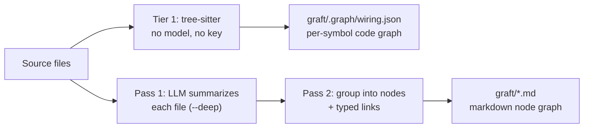

# Upstream reference

This reference comes from Trail-Code 0.28.0's README. It covers the commands, languages and graph format that GrievousGreps inherits. Where this distribution differs, the [README](../README.md) wins: see its 'Compared with upstream' section.

## How the graph gets built

The graft map is built in layers. Tier 1 is tree-sitter: every symbol and call edge, no model, no key. `trail build --deep` adds two language-model passes on top:

1. **Read each file.** Every source file is summarized once into a short description of what it does.
2. **Group into nodes.** Those summaries are grouped into a curated set of nodes (subsystems, key files, and concepts) with typed links between them. The graft map chooses the right level of detail for you instead of making one node per file, so a big repo becomes a few dozen readable nodes.



Every pass is cached by content hash, the LLM ones and the tree-sitter parse alike. Re-running only touches the files that changed, so the second build is fast and cheap (on this repo, 312 files: about 5s cold, about 0.6s after one edited file or with nothing changed). `trail build --no-reuse` forces a cold re-parse.

That cheapness is what lets **every query refresh the graph before it answers**. A retrieval call stats the tree against the last build's fingerprint (about 50ms on this repo), and rebuilds only if something moved, so `ask`/`grep`/`callers`/`skeleton`/`map` describe the code as it is right now, including edits that are unsaved to git: uncommitted, unstaged, or staged all look the same to the graft map. Git determines the visible file set; freshness compares the working-tree bytes rather than commit or index state. The refresh is structural and `$0`; it never calls the LLM. Turn it off per-command with `--no-refresh`, or everywhere with `GRAFT_NO_REFRESH=1`.

Alongside the markdown graph, `trail build` builds `graft/.graph/wiring.json` (a per-symbol code graph) plus a per-file wiring card mirroring your source tree. Tier 1 is pure tree-sitter (every function, class, and call edge; deterministic, no model, no network), which is why plain `trail build` needs no key. The `--deep` pass adds a one-line summary and a crux excerpt per symbol, cached by body hash.

---

## Supported languages

The graft map parses with tree-sitter at two levels of fidelity, plus an optional
compiler-grade layer, all `$0` and deterministic (no model, no key):

- **Full-fidelity**: hand-written extractors with scope-aware, cross-file call
  and import resolution:
  **TypeScript / JavaScript** (incl. JSX & TSX), **Python**, **Go**, **Java**,
  **Kotlin**, **PHP**, **Swift** (classes, structs, enums, actors, protocols;
  extension members attach to the extended type), **R** (`.R`/`.r`: plain
  functions, S3/S4/R6 classes and methods, roxygen `@export`,
  `library()`/`source()` imports), and **Vue** single-file components (their
  `<script>` blocks go through the TypeScript extractor).

- **Broad**: symbols (functions, classes, methods, types, …) plus name-resolved
  call edges via a generic tree-sitter extractor, one grammar per language:
  **Rust, C, C++, C#, Ruby, Scala, Elixir, Solidity,
  Dart, Clojure, Nix, Lua, Gleam**, and **OCaml, Zig** (symbols only for now, no call edges).

- **Compiler-grade edges (opt-in)**: `trail build --lsp` adds precise
  `lsp_resolved` call edges (member calls the static pass can't type) when a
  language server is on your `PATH`. It uses the first one installed, in this
  order, one server per build: **rust-analyzer** (Rust), **clangd** (C/C++),
  **gopls** (Go), **pyright** (Python), **typescript-language-server** (TS/JS).
  It's best-effort: with no server installed the graph is unchanged.

Twenty-four languages, plus Vue single-file components. A file whose language isn't listed is skipped, not
indexed. Adding a broad-tier language is a small contribution; see
[CREDITS.md](../CREDITS.md) for the folks who added the current set.

---

## What's in a node

A node is a single markdown file. Most code maps stop at an address: this thing lives in that file, on that line. That tells an agent where to look, not what it will find, so it still has to open the source and read. A graft map node holds the meaning inline, so the agent learns what it needs up front and opens the file only when it wants more.

Each node holds:

| Part | What it holds |
|---|---|
| **Summary** | A plain-English explanation of what the code does, written by the model and cached. It is there whether or not the code was ever documented, and it is regenerated when the source changes. |
| **Crux** | The handful of lines that actually carry the logic: the guard, the skip condition, the state change. Lifted straight from the source and stored inline, so the agent sees *how* it works, not just what. |
| **Sources** | The exact files the node is built from, each tracked by a content hash, so the graft map can tell precisely when a node has gone stale. |
| **Links** | Typed connections to other nodes (`depends_on`, `part_of`, `uses`, `implements`, `produces`), written as `[[wikilinks]]` your agent can follow. |
| **Your text** | Anything you write below the generated block. It is preserved across regenerations, so your own context is never overwritten. |

That is three depths in one file: the summary says *what* the code does, the crux shows *how*, and the sources point to the rest if the agent needs it. A plain index makes it read a whole file to learn one thing. A graft map node hands it the answer inline, and the follow-up read often never happens.

The crux is stored as the code itself, not as a line range, on purpose. Line numbers drift whenever unrelated code above them shifts, but the lines that matter do not. Keeping the text, not the numbers, means the crux stays correct even as the file around it moves.

_Summary, sources, links, and your text ship today in markdown nodes. The crux ships per-symbol in the code graph (`trail build --deep`); inlining it into markdown nodes is next._

---

## CLI

`trail --help` lists the commands in four groups. Every `graft` command still works too.

```bash
# find code · your agent runs these
trail ask "<task>" [dir]             # the matching code and learnings: ranked nodes + exact file:line (no LLM, no key)
trail ask "<task>" --json            # machine-readable result
trail ask "<task>" --in <scope>      # narrow to one sub-project of a monorepo/multi-repo folder (see below)

trail grep "<regex>" [dir]           # exhaustive regex search over indexed files, grouped by enclosing symbol (no LLM, no key)
trail grep "<regex>" --in <path>     # narrow to files at or under this path prefix
trail grep "<regex>" -i --fixed      # case-insensitive; treat the pattern as a literal string, not a regex

trail skeleton <file> [dir]          # every signature in one file, no bodies: the API surface for ~1/10th the tokens (no LLM, no key)

trail callers <symbol> [dir]         # who calls/references/imports/implements/extends a symbol (no LLM, no key)
trail callers <symbol> --direction out  # the reverse: what the symbol itself calls/references
trail callers <symbol> -d N          # walk transitively out to depth N: full blast radius

trail map [dir]                      # token-budgeted repo orientation: dir clusters, hubs, hotspots (no LLM, no key)
trail map --max-dirs N               # raise/lower the number of directories shown

# ask / skeleton / callers / grep / map / blast all refresh the graph first if the working tree moved:
#   --no-refresh                     # answer from the graph exactly as it is on disk
#   GRAFT_NO_REFRESH=1               # same, for every command
#   GRAFT_REFRESH=hash               # hash every file instead of trusting size+mtime
#   TRAIL_NO_FIRST_BUILD=1           # a repo with no map stays untouched; a built map still refreshes
#   TRAIL_NO_SAVINGS_TALLY=1         # keep the tokens-saved line, drop the request to report a total

# learnings
trail note --title "<about>" [dir]   # save a learning: what this session decided, tried and ruled out (the text on stdin)
trail note --always-follow           # mark it always follow: your agent won't go against it, even if asked
trail note --personal                # about your own setup, not the code: keep it in ~/.trail, out of the repo
trail check [dir]                    # check your branch's diff against the repo's learnings, yours and your skills (exit 1 on a conflict)
trail check --base origin/main       # compare against this base instead of origin's default branch
trail team [dir]                     # what the team learned this week, who's working on what, and where work overlaps
trail skills [--json]                # your skills: scope, status, uses; held ones; jobs Trail is counting; offers
trail skills off | on [<name>]       # skills are on by default: turn them off, or back on (only you, in your own terminal); or one skill
trail skills offers on | off [--here] # skill offers everywhere, or just this repo (only you turn them on)
trail skills show <name>             # print a skill and its status
trail skills keep <name>             # keep a skill Trail held because nobody said yes (only you)
trail forget <name>                  # forget a skill; trail skills restore <name> brings it back

# setup
trail init [dir]                     # pick which agents to wire (prompts on a terminal; writes nothing until you choose)
trail init --dry-run                 # list the agent wiring it would write, then exit
trail init --agents cursor kiro      # wire only these agents, no prompt (ids: agents, adal, cursor, gemini, grok, hermes, antigravity, copilot, kiro, windsurf, claude)
trail init --yes                     # no prompt; wire every detected agent
trail init --global                  # also write outside this repo (~/.claude, ~/.claude.json, ~/.codex, ~/.gemini)
trail init --no-statusline           # skip Claude Code statusLine (same as GRAFT_NO_STATUSLINE=1)
trail init --no-build                # wire the files only; don't build the graph
trail init --all-agents              # wire every known agent, detected or not
trail init --list-agents             # list known agent ids and exit

trail build [dir]                    # build the graft map in graft/: wiring graph + per-file cards (no LLM, no key)
trail build --deep                   # add the LLM layer: concept nodes + per-symbol summary/crux (cached)
trail build --check                  # build nothing: fail (exit 1) if graft/ has drifted from the code, for CI
trail build --deep -e .ts .py        # with --deep: only summarize these extensions
trail build --no-reuse               # re-parse every file instead of replaying unchanged ones from cache
trail build --follow-submodules      # include initialized submodules; persist the choice for builds + MCP refresh
trail build --no-follow-submodules   # exclude submodules again and persist that choice (the default)
trail build --follow-nested-repos    # include nested git clones the index doesn't track; persist the choice
trail build --no-follow-nested-repos # exclude nested clones again and persist that choice (the default)

trail status [dir]                   # the graft map, learnings and tokens saved, on one screen
trail upgrade                        # refuses on this distribution: see the README
trail uninstall [dir]                # remove every file and config entry it wrote here (the inverse of init)
trail uninstall -y                   # actually remove (without -y it prints what it would remove and exits)
trail uninstall --keep-cache         # wiring only; leave graft/ and the .gitignore entry
trail uninstall --no-global          # leave out-of-repo files alone (~/.claude, ~/.claude.json, ~/.codex, ~/.gemini)
trail telemetry [status|enable|disable|debug]   # anonymous usage stats; debug prints exactly what would be sent

# CI
trail blast [dir]                    # blast radius of a diff: what depends on the lines this change touched (no LLM, no key)
trail blast --base origin/main       # diff against the merge base with HEAD (what a PR job runs)
trail blast --format markdown        # a PR comment: the areas a change can reach, per-symbol detail collapsed under it
trail blast --base origin/main --name  # name those areas with one cached LLM call, instead of a full --deep build
trail blast --export-viz site/       # also write the interactive page for this radius (what a PR comment links to)
trail blast --no-owners              # skip "who to tag" (by default, git history names the people behind each area)
trail blast --depth all --format json  # the full transitive closure, machine-readable

# not listed in --help, still there
trail viz [dir]                      # see the graph: serves an interactive viewer on localhost
trail viz --export site/ --title "PR #12"  # one self-contained index.html for CI, GitHub Pages, or a build artifact
trail mcp [dir]                      # run the MCP server by hand

# global
trail --dir <path>                   # use a context dir other than <repo>/graft
trail --version, -v                  # print the installed version and exit
```

Method calls resolve through the receiver's type, using constructor assignments
(`self.router = APIRouter()`) and type annotations, not just the call-site
name, so `callers`/`grep --in` return calls bound to the right
type on method-heavy code, not every method anywhere with that name.

## Search & orient (`trail grep` / `trail map`)

`trail grep "<regex>"` is exhaustive over every indexed file and groups hits
by enclosing symbol, ranked by the same in-edge coupling `trail map` uses.
It's built for "every occurrence of this pattern" tasks where `trail ask`'s
ranked top-N isn't enough:

```
"NEEDLE" — 2 hits in 2 symbols across 1 files (searched 1 indexed files)

heavilyCalled · function · src/a.ts:L1-L3 · 3 in-edges
  L2: console.log("NEEDLE hit in heavilyCalled");

rarelyCalled · function · src/a.ts:L4-L6 · 0 in-edges
  L5: console.log("NEEDLE hit in rarelyCalled");
```

`trail map` is a token-budgeted first look at a repo: directory clusters
with file/symbol counts, each dir's local hubs, and the global hotspots,
all ranked by in-degree, no LLM, no key:

```
repo map — 313 files · 2349 symbols · 8148 edges · javascript, typescript

src/                157 files · 1804 symbols   hubs: wiringPath (write.ts, 48←), cmd (brand.ts, 45←), buildGraph (build.ts, 39←)
test/               144 files · 467 symbols   hubs: tmpRepo (helpers.ts, 46←), fetch (app-identity.test.ts, 7←), fakeProviders (helpers.ts, 5←)
viewer/             5 files · 71 symbols   hubs: $ (main.ts, 9←), cvar (data.ts, 6←), activeGraph (main.ts, 5←)
scripts/            7 files · 7 symbols   hubs: bump (graph-quality.mjs, 1←), defaultTranscriptDir (tally-audit.mjs, 1←), flush (tally-audit.mjs, 1←)

hotspots: wiringPath · function · src/graph/write.ts:L20-L22 · 48←  tmpRepo · function · test/helpers.ts:L30-L32 · 46←  cmd · function · src/brand.ts:L63-L70 · 45←  ...
```

## Monorepos, submodules & multi-repo folders

The graft map supports these layouts:

- **A monorepo with one `.git`** (a `pnpm-workspace.yaml`/`package.json`
  `workspaces`, or per-package `go.mod`/`pyproject.toml`/`Cargo.toml`):
  `trail build` discovers each sub-project as a ranking scope. `ask`/`map`
  rank every scope on its own terms and fuse the results, so the biggest
  sub-project can't drown a small one; hits carry `[scope/]` labels, and
  `trail map` groups its directory clusters by scope first.
- **A Git superproject with initialized submodules**: submodules stay excluded
  by default. Run `trail build --follow-submodules` to fold initialized gitlinks
  into one graph, prefixing child paths (for example,
  `deps/parser/src/index.ts`) while honoring each submodule's own Git ignore
  rules. Visible untracked files are included too; uninitialized submodules
  remain absent until `git submodule update --init` checks them out. The choice
  is saved in `.graft/config.json`, so later no-flag builds and MCP automatic
  refreshes behave the same way. Run `trail build --no-follow-submodules` to
  restore and persist the default boundary.
- **A git repo with other repos cloned inside it** (no gitlink, no index entry): the shape multi-repo manifest tools like `west`, `repo`, `gclient` and `tsrc` check dependencies out into, and the shape you get by cloning an upstream into the tree to patch it locally. `--follow-submodules` cannot reach these: they have no `160000` index entry to follow. Run `trail build --follow-nested-repos` to fold them into one graph, prefixing child paths (for example, `external/parser/src/index.ts`) while honoring each clone's own Git ignore rules. A clone at a git-ignored path stays absent, since Git never reports it. The choice is saved in `.graft/config.json` and is independent of `--follow-submodules`; neither flag implies the other. Run `trail build --no-follow-nested-repos` to restore and persist the default boundary. Prefer this over the multi-repo split below when the nested repos import from each other and you want those edges in one graph; prefer the split when you want each repo scored and refreshed on its own.
- **A folder of separate git repos** (no `.git` at the top): `trail build`
  auto-splits: each child gets its own (git-ignored) `graft/`, and the parent
  gets a `graft/workspace.json` index. Queries from the parent federate across
  every child, always labeled `<child>/`. Run `trail build` inside a child to
  work on just that repo.

In every layout, narrow to one sub-project with `trail ask "<task>" --in <scope>/`
once you know where you're working.

`trail init` at the parent of a multi-repo folder wires **every child repo too**,
not just the parent. An agent session opens at a repo root and reads its
instruction files from there, so each child needs its own. A session started in
the parent gets the federated view; one started in a child sees that repo alone.

Commands also find the graph from a subdirectory: with no `[dir]` argument they
walk up to the nearest `graft/`, so `trail ask` works from `src/deep/inside/`
without a `cd` to the repo root.

## Visualize it (`trail viz`)

`trail viz` opens a local, interactive view of both graphs. No install, no dev
server; the viewer ships prebuilt inside the package.

- **Context** tab: the architecture graph from `graft/*.md`. Nodes colored by
  type, sized by connectedness.
- **Code** tab: the per-symbol graph from `graft/.graph/wiring.json` (run `trail build` first).
- **Outline** tab: the file → class → method hierarchy as a collapsible tree.

Edges speak the code's language. Every link is one of a closed set of verbs, each
answering a question someone building or reviewing code actually asks:

| Verb | The question it answers |
|---|---|
| `part_of` / `contains` | where does this live? |
| `uses` / `calls` / `imports` / `depends_on` | what breaks if I change this? |
| `produces` | where does this output come from? |
| `configures` | what changes its behavior without a code change? |
| `validates` | what checks or judges this? (tests, drift checks, scoring) |
| `extends` / `implements` | what contract must this honor? |
| `references` | what names this without calling it? (drawn as faint dots) |

Select a node and its edges take on direction: **amber = what it depends on,
indigo = what depends on it**, with the verb written on each highlighted edge.
Chips above the canvas filter by verb; edges the parser resolved exactly draw
solid, while edges matched by name alone, or inferred by the model, draw dashed. The viewer live-reloads when `graft/`
changes on disk. Older graphs with vague verbs (`influences`, `supports`) are
normalized on load, so no regeneration is needed.

---
